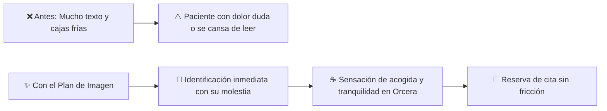
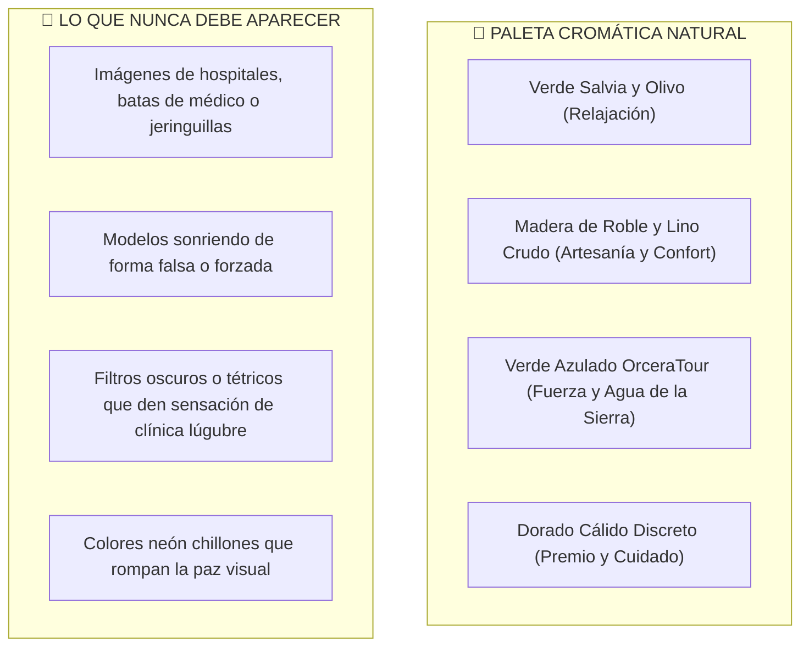

# 🎨 Plan Estratégico de Imagen & Recursos Visuales: M&H Bienestar
## *"Más vale una imagen que 1000 palabras": Humanizar, dar calidez y conectar con los vecinos de Orcera*
**Ubicación:** Calle San José, 2, 23370 Orcera (Jaén) · **Marca:** M&H Bienestar Integral

---

## 1. Diagnóstico y Visión: ¿Por qué la imagen transforma esta app?

En una web o aplicación de bienestar, quiromasaje y reeducación corporal, **el texto explica la técnica, pero la imagen es la que quita el miedo, transmite confianza y genera la reserva**.

Actualmente, muchas pantallas de la aplicación dependen en exceso de cajas de texto, fondos planos o fotos genéricas de stock de Unsplash (con modelos impersonales que no reflejan la calidez de un centro en la Sierra de Segura).

### Los 3 Principios de la Estrategia Visual de M&H:
1. **Empatía con el dolor del paciente:** Que al mirar una imagen de cuello o espalda, la persona sienta: *"Ahí justo es donde me duele a mí y saben cómo aliviarlo"*.
2. **Calidez de la Sierra de Segura:** Tonos naturales (madera de roble, lino crudo, toallas en verde salvia, ramas de olivo y lavanda, luz de mañana), huyendo de la frialdad hospitalaria.
3. **Hospitalidad y cercanía rural:** Mostrar una bienvenida real (una infusión relajante, una camilla acogedora, un sobre artesanal de regalo), haciendo la app simpática, agradable y familiar para jóvenes y personas mayores.

---

## 2. Detección de Ubicaciones: ¿Dónde lucirá mucho mejor incrustando imágenes?

Hemos analizado cada pantalla y componente de la app. A continuación, el mapa de oportunidades visuales ordenado por impacto:

| Zona de la App | Situación Actual | Oportunidad Visual / Mejora | Impacto Emocional |
| :--- | :--- | :--- | :--- |
| **1. Hero de la Home (`/`)** | Foto genérica de stock o bloque oscuro. | **Escena real y luminosa de la camilla de M&H en Orcera** con toallas de algodón orgánico, frasco de aceites naturales y vistas serenas a la sierra. | Paz inmediata y sensación de estar entrando al centro. |
| **2. Selector de Molestias ("¿Dónde te duele?")** | Botones de texto con iconos genéricos. | **4 mini-ilustraciones corporales amables** señalando con un halo cálido la zona de tensión (Espalda, Cuello/Mandíbula, Abdomen/Estrés, Piernas). | *"¡Justo eso tengo yo!"* (conexión en 1 segundo). |
| **3. Test de Tensión Muscular (Quiz)** | Formulario textual de 3 preguntas. | **Cabecera ilustrada simpática** (un personaje soltando una mochila pesada o relajando los hombros). | Hace el test divertido, cercano y apetecible de completar. |
| **4. Tarjetas de Servicios (`/servicios`)** | Imágenes de stock desvinculadas entre sí. | **Colección fotográfica coherente por terapia:** • *Alivio de Espalda:* Toalla templada y descompresión. • *Bruxismo & Cuello:* Maniobra craneofacial serena. • *Bienestar Visceral:* Manos suaves en diafragma. • *Craneosacral:* Calma del sistema nervioso. | Claridad absoluta de qué va a recibir el paciente en cabina. |
| **5. Bonos y Regalos (`/bonos-y-regalos`)** | Tablas de precios frías. | **Fotografía de la Tarjeta Regalo física y digital** en sobre de papel kraft con lazo verde salvia y detalle dorado. | Despierta el deseo de regalar salud en cumpleaños o aniversarios. |
| **6. Pantalla de Confirmación de Cita (`/reservar`)** | Solo texto con código alfanumérico. | **Foto acogedora de bienvenida:** Taza de infusión caliente con tarjeta manuscrita: *"¡Cita confirmada! Tu momento de paz te espera en Orcera"*. | Elimina cualquier duda o frialdad tras reservar. |
| **7. Club Bienestar / Recomienda a un Amigo (`/mi-cuenta`)** | Caja de texto con código y enlace. | **Ilustración simpática de dos amigos compartiendo un momento de bienestar**, enmarcando el código QR. | Estimula el boca a boca y la recomendación vecinal. |
| **8. Portal de Paciente - Mi Historia (`/mi-cuenta`)** | Pestañas técnicas. | **Sello gráfico de "Confidencialidad Médica RGPD"** y gráfico visual de evolución muscular (de contractura a ligereza). | Orgullo de ver su progreso y seguridad en sus datos. |
| **9. Acceso y Registro (`/login`)** | Formulario estándar oscuro. | **Imagen lateral de acogida** en la consulta de Orcera con luz natural. | Transmite cercanía frente a una pantalla de registro fría. |

---

## 3. Catálogo de Imágenes Desarrolladas para el Proyecto

Hemos comenzado la producción de imágenes maestras personalizadas para M&H Bienestar, generadas con calidad fotográfica y listas en la carpeta `public/images/`:

### 🖼️ Imagen 1: Hero Principal de Bienestar en Orcera
* **Archivo:** `public/images/hero-bienestar-orcera.jpg`
* **Dimensiones:** 1920 × 1080 (16:9, alta resolución)
* **Descripción:** Escena fotográfica hiperrealista y cálida de una camilla de madera ergonómica con ropa de cama orgánica en tonos crudo y salvia, toallas gofradas, un vial de cristal con aceite esencial de almendras y romero, y una ramita de olivo y lavanda, iluminada por un ventanal de madera con vistas a los pinares de la Sierra de Segura.
* **Ubicación en app:** Cabecera de la página de Inicio (`src/app/page.tsx`).

### 🖼️ Imagen 2: Tarjeta Regalo & Bonos de Desconexión
* **Archivo:** `public/images/tarjeta-regalo-mh.jpg`
* **Dimensiones:** Cuadrada / Panorámica
* **Descripción:** Fotografía editorial de la tarjeta de regalo en papel texturizado con letras en relieve dorado *"M&H Bienestar · Regalo de Salud y Desconexión"*, presentada en un sobre artesanal abierto con lazo de lino salvia, sobre madera rústica con hojas de olivo.
* **Ubicación en app:** Cabecera de Bonos y Regalos (`src/app/bonos-y-regalos/page.tsx`).

### 🖼️ Imagen 3: Hospitalidad y Cita Confirmada ("Tu Infusión de Bienvenida")
* **Archivo:** `public/images/cita-confirmada-exito.jpg`
* **Dimensiones:** 1200 × 800
* **Descripción:** Taza humeante de cerámica artesanal con infusión relajante de hierbas, rodaja de limón y tarjeta de bienvenida personalizada en la acogedora sala de recepción del centro en Orcera.
* **Ubicación en app:** Paso 4 de Confirmación Exitosa de Reserva (`src/app/reservar/page.tsx`).

### 🖼️ Imagen 4 a 7: Colección Iconográfica de Zonas de Molestia
* **Archivos propuestos:**
  1. `zona-espalda-lumbar.svg/webp`: Silueta con foco en descompresión dorsal y lumbar.
  2. `zona-cervical-bruxismo.svg/webp`: Silueta liberando la mandíbula y cuello.
  3. `zona-visceral-estres.svg/webp`: Silueta con manos en plexo solar y diafragma.
  4. `zona-piernas-movilidad.svg/webp`: Silueta ágil recuperando la pisada y piernas ligeras.
* **Ubicación en app:** En el componente `src/components/PainPointSelector.tsx`.

---

## 4. Guía de Estilo Visual: El "Toque M&H Orcera"

Para que cualquier imagen que se incorpore mantenga una estética coherente, profesional y agradable, seguimos estas directrices:

---

## 5. Plan de Implementación (Fases Opcionales)

Este plan está listo para activarse en el momento que tú decidas:

### Fase 1: Impacto Inmediato (15 minutos de implementación)
* Reemplazar la imagen del Hero de la Home por `hero-bienestar-orcera.jpg`.
* Incorporar la imagen de la Tarjeta Regalo en la sección de Bonos.
* Añadir la imagen cálida de confirmación en la pantalla final de Reserva.

### Fase 2: Simpatía y Conexión en Molestias (Fase media)
* Incrustar las mini-ilustraciones en el selector de zonas de dolor (`PainPointSelector.tsx`).
* Añadir el avatar amigable en el test de tensión muscular (`BodyTensionQuiz.tsx`).

### Fase 3: Fotografías Reales de Ramón en la Consulta (Fase definitiva)
* Cuando Ramón tome 3 o 4 fotos reales de la camilla y la consulta en Calle San José con buena luz, se sustituyen en el carrusel de servicios para lograr el 100% de autenticidad local.

---

*Documento redactado y registrado en `docs/PLAN_IMAGEN_APP_MH.md` para revisión.*

