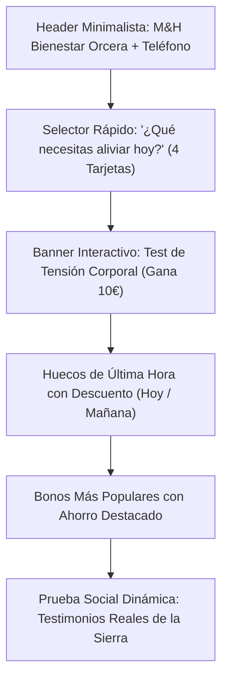
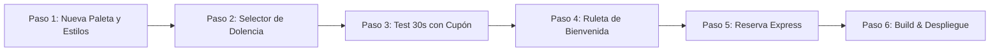

# 🌿 Plan Integral de Mejora, Experiencia Visual y Motor de Ventas
## M&H Bienestar Integral (Orcera, Jaén)
*Documento Estratégico y Hoja de Ruta de Implementación Paso a Paso*

---

## 1. Diagnóstico: Por qué el diseño actual no engancha ni vende

| Aspecto | Estado Actual | Problema Detectado | Solución Propuesta |
| :--- | :--- | :--- | :--- |
| **Colorido y Ambiente** | Verde apagado (`#2E5D4A`) y Crema (`#F8F7F2`) | Parece un prospecto farmacéutico o herbolario antiguo; carece de luz, vida y energía moderna. | **Paleta Esmeralda Joya + Menta Vibrante + Oro Champagne** sobre fondos blancos pulcros y cristal translúcido (*glassmorphism*). |
| **Arquitectura de Información** | Parrafadas de texto y descripciones clínicas largas | En el móvil el cliente escanea en 3 segundos; no lee explicaciones anatómicas extensas. | **Navegación por Dolencias/Objetivos en 1 Toque**: El cliente elige qué le duele y la app le da la solución inmediata. |
| **Impulso de Compra** | Catálogo informativo estático | No hay sensación de urgencia, ofertas atractivas ni llamadas a la acción irresistibles. | **Ganchos de Venta Reales:** Test de Tensión Corporal en 30s (con cupón de 10€), Huecos de Última Hora con dto., Bonos con Ahorro Visible. |
| **Engagement / Viralidad** | Formularios convencionales | La app no invita a ser abierta todos los días ni a compartirla con amigos o familiares. | **Gamificación Comercial:** Ruleta o Rasca de Bienvenida donde el cliente siempre gana un incentivo canjeable. |
| **Flujo de Reserva** | Varios pasos con formularios tradicionales | Provoca abandono de carritos si hay fricción. | **Reserva Express en 3 Pasos:** Selector deslizante tipo carrusel (Hoy, Mañana...) + chips horarios. |

---

## 2. Nueva Identidad Visual: "Vitalidad, Salud Vibrante & Lujo Silencioso"

```
┌───────────────────────────────────────────────────────────────────────────┐
│                          PALETA DE ALTO IMPACTO                            │
│                                                                           │
│   [#044E39]          [#10B981]          [#D4AF37]          [#FFFFFF]     │
│ Verde Esmeralda    Verde Menta Fresca   Oro Champagne     Blanco Puro     │
│ (Fuerza y Lujo)    (Acción y Energía)   (Premios/Ahorro)  (Luz y Limpieza)│
└───────────────────────────────────────────────────────────────────────────┘
```

1. **Fondo Principal:** Blanco puro (`#FFFFFF`) y gris perla ultra-ligero (`#F9FAFB`), creando una atmósfera amplia, limpia y luminosa.
2. **Color de Marca:** Verde Esmeralda Joya (`#044E39`), que proyecta profesionalidad médica y distinción parasanitaria.
3. **Color de Acción / Botones de Venta:** Verde Menta Eléctrico (`#10B981` / `#059669`), que destaca de inmediato a la vista e invita al clic impulsivo.
4. **Color de Valor y Premios:** Oro Champagne (`#D4AF37`) y Ámbar cálido para resaltar descuentos, estrellas de opiniones y premios del club.
5. **Estética Visual:** Tarjetas flotantes con esquinas ultra-redondeadas (24px a 32px), sombras multicapa sutiles (*ambient glow*) y sensación táctil optimizada para el dedo pulgar.

---

## 3. Arquitectura de Pantalla de Inicio: Diseñada para Vender en Segundos

En lugar de una cabecera genérica con fotos de stock, la pantalla principal guiará al cliente mediante este embudo visual:



### Detalle de Componentes Clave:

### A. Selector Visual de Dolencias en 1 Toque
Pregunta directa: **"¿Qué necesitas aliviar o mejorar hoy?"**
* 💥 **Dolor de Espalda o Cuello:** Cervicales, lumbares, contracturas y ciática. *(Redirige directo a Reeducación Corporal).*
* 🧘 **Estrés, Bruxismo o Cansancio Mental:** Mandíbula apretada, migrañas y dificultad para dormir. *(Redirige a Craneosacral).*
* 🏃 **Sobrecarga Muscular o Piernas Cansadas:** Tensión deportiva, piernas pesadas y fatiga. *(Redirige a Masaje Profundo).*
* 🪷 **Postura y Movilidad Activa:** Prevención, reeducación postural y pilates. *(Redirige a Sesión de Movilidad).*

### B. Evaluador de Tensión Corporal en 30 Segundos (Lead Magnet)
* Mini-test de 3 preguntas interactivas con botones visuales grandes:
  1. *¿Cuántas horas al día pasas en la misma postura (sentado/de pie)?*
  2. *¿Sientes sobrecarga, pinchazo o sensación de ardor muscular?*
  3. *¿Te cuesta conciliar el sueño o aprietas los dientes por tensión?*
* **Resultado:** La app calcula su "Nivel de Tensión" (Bajo / Medio / Crítico) y le regala un **Cupón de Bienvenida de 10€** exclusivo para reservar durante las próximas 48 horas.

### C. Sección de "Huecos Libres de Última Hora (-15%)"
* Llena las cancelaciones o huecos muertos de agenda:
  * *"Hoy a las 18:30 h · 1 hueco libre con 15% dto."*
  * *"Mañana a las 11:00 h · 1 hueco libre con 15% dto."*
* Crea urgencia real y aprovecha las horas que de otro modo quedarían sin facturar.

### D. Bonos Multisesión Presentados con Psicología de Ahorro
* ❌ Antes: *"Bono 3 sesiones 135€"*.
* ✅ Nuevo: **"Pack Recuperación Total: Ahorras 25€ + Pauta personalizada para casa de regalo"** (Etiqueta *"🔥 Más Elegido por los Pacientes"*).

### E. Ruleta / Rasca de la Suerte de Bienvenida
* Al registrarse o pulsar el botón de bienvenida, el usuario gira una ruleta digital:
  * 🎁 5€ de dto. en su primera reserva.
  * 🎁 10 minutos extra de relajación craneal en su cita.
  * 🎁 50 puntos directos para el Club M&H.
  * 🎁 1 Pase amigo con 10% de dto.
* Fomenta que los clientes hablen de la aplicación en Orcera y la compartan por WhatsApp.

---

## 4. Reserva Express en 3 Pasos (Sin Fricción)

1. **Paso 1: Selección de Servicio / Necesidad** (Preseleccionado automáticamente si viene del selector de dolor).
2. **Paso 2: Día y Hora en 1 Pantalla**
   * Selector horizontal deslizante: `Hoy`, `Mañana`, `Miércoles 11`, `Jueves 12`...
   * Chips horarios agrupados: `🌅 Mañana (10:00, 11:30)` y `🌇 Tarde (17:00, 18:30, 20:00)`.
3. **Paso 3: Confirmación con 1 Botón**
   * Nombre, Teléfono, WhatsApp de confirmación automática y recordatorio a las 24 horas.

---

## 5. Plan de Ejecución Paso a Paso



| Fase | Tarea Específica | Entregable Concreto |
| :--- | :--- | :--- |
| **Paso 1** | **Renovación de Colorido y Tailwind** | Actualizar `tailwind.config.js` y `globals.css` con Esmeralda `#044E39`, Menta `#10B981` y Oro `#D4AF37`, eliminando el crema apagado. |
| **Paso 2** | **Selector Visual de Dolencias** | Crear el componente interactivo `PainPointSelector.tsx` y situarlo en la cabecera de la Home. |
| **Paso 3** | **Evaluador de Tensión de 30s** | Implementar `BodyTensionQuiz.tsx` con generación de cupón de 10€ y redirección con descuento aplicado a `/reservar`. |
| **Paso 4** | **Ruleta de Premios de Bienvenida** | Crear `WelcomeRewardWheel.tsx` interactivo accesible desde la Home y el menú móvil para captar registros y viralizar. |
| **Paso 5** | **Optimización de Reserva Express** | Rediseñar el carrusel de fechas y chips horarios en `src/app/reservar/page.tsx` para permitir reservar en menos de 20 segundos. |
| **Paso 6** | **Validación, Build & Subida a Main** | Ejecutar pruebas en móvil, verificar TypeScript, compilar y desplegar en Vercel producción. |

---

## 6. Resultados Esperados tras la Transformación

1. **Impacto Visual Inmediato:** Una interfaz viva, limpia y de gama alta que transmite confianza y profesionalidad desde el primer segundo.
2. **Aumento del Ratio de Conversión:** De un catálogo estático a una herramienta activa que recomienda el servicio idóneo según lo que le duele al cliente.
3. **Mayor Ticket Medio y Retención:** Venta facilitada de Bonos con ahorro explícito y fidelización gamificada con puntos y premios del Club M&H.
4. **Viralidad Local:** Facilidad para compartir la ruleta de premios y los enlaces de recomendación entre familias y vecinos de la comarca.

---
*Centro Parasanitario M&H Bienestar Integral · Calle San José, 2, Orcera (Jaén) · Tel/WhatsApp: 651 30 87 38*

