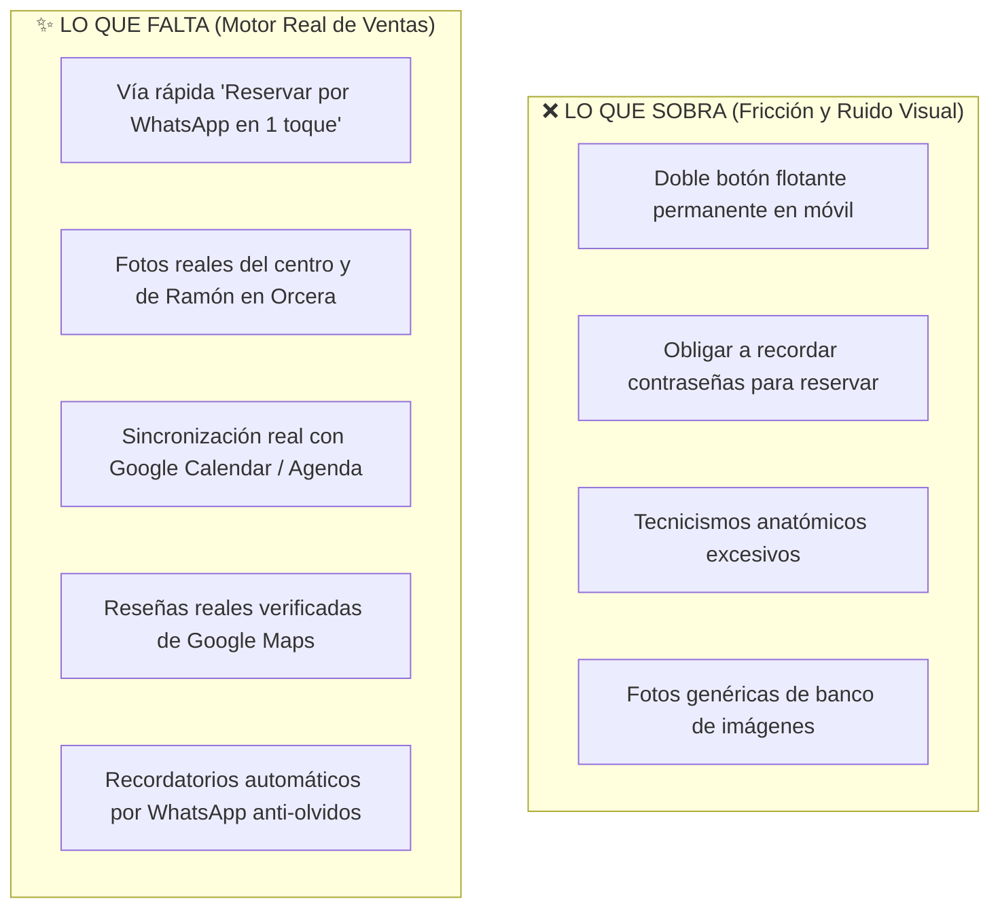
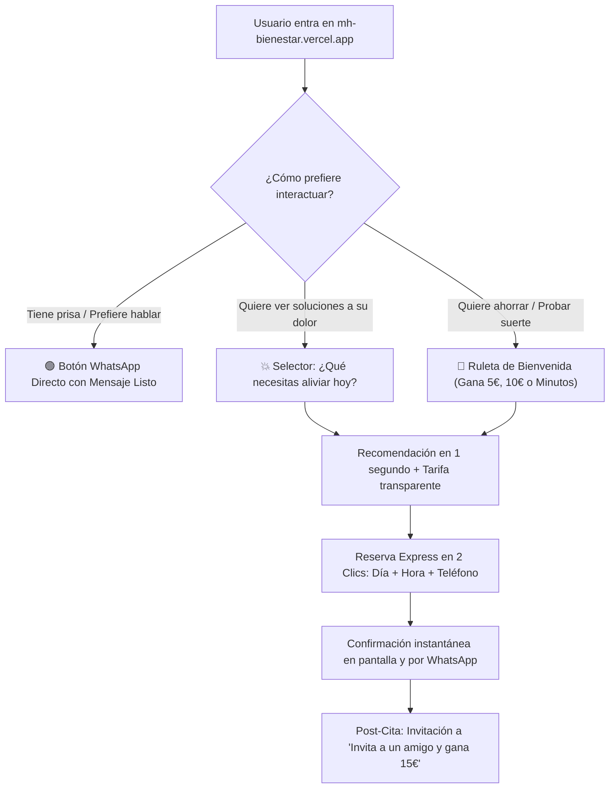

# 📋 Análisis Crítico y Plan de Evolución Estratégica: M&H Bienestar Integral
## *Qué le sobra, qué le falta, qué poner y qué quitar para maximizar reservas y ventas en Orcera*
**Ubicación:** Calle San José, 2, 23370 Orcera (Jaén) · **Marca:** M&H Bienestar Integral

---

## 1. Diagnóstico Honesto: ¿Qué le sobra y qué le falta a la app hoy?

Habiendo implementado la primera fase (paleta oficial de OrceraTour Día/Noche, ruleta, selector de molestias, quiz de tensión y bonos), este es el análisis profesional de usabilidad y negocio para un centro en la Sierra de Segura:

---

## 2. Detalle: Qué le SOBRA (Lo que yo QUITARÍA)

| Elemento a Quitar / Simplificar | Por qué sobra | Qué hacer en su lugar |
| :--- | :--- | :--- |
| **1. Doble botón flotante en móvil (Ruleta + Gana 15€)** | En pantallas pequeñas de móvil, tener dos botones flotantes a izquierda y derecha + la barra inferior (`BottomNav`) tapa el texto y asfixia al usuario. | **Unificar:** Dejar un único botón flotante inteligente (o integrar la ruleta como un banner atractivo dentro del flujo de la Home sin flotar continuamente). |
| **2. Exigencia de Contraseña / Registro formal** | En Orcera y pueblos vecinos, obligar a inventarse y recordar una contraseña para reservar un masaje o cita genera abandono inmediato en clientes de más de 45 años. | **Reserva sin fricción:** Se reserva únicamente con Nombre + Teléfono (WhatsApp). La cuenta se vincula automáticamente en segundo plano por su número de móvil. |
| **3. Tecnicismos clínicos y nombres abstractos** | Nombres como *"Terapia Craneosacral Biodinámica"* o *"Descompresión Miofascial"* intimidan al paciente común con dolor de espalda. | **Traducir al lenguaje del paciente:** *"Alivio de Cuello, Cabeza y Bruxismo"*, *"Descarga de Espalda y Lumbares"*, *"Paz Mental y Desconexión"*. El detalle técnico se deja en letra pequeña para quien quiera profundizar. |
| **4. Secciones vacías o estáticas (como el Blog ya retirado)** | Un centro de bienestar no es un periódico; el usuario entra a buscar alivio a su dolor y pedir hora, no a leer artículos de 10 páginas. | **Acierto confirmado:** Mantener el Blog fuera y concentrar el 100% de la app en **conversión, citas y fidelización**. |

---

## 3. Detalle: Qué le FALTA (Lo que yo PONDRÍA)

| Elemento Nuevo a Incorporar | Impacto en Ventas y Clientes | Cómo se implementa |
| :--- | :--- | :--- |
| **1. Botón "Reserva Directa por WhatsApp en 1 Clic"** | Es la vía favorita del 70% de clientes en zonas rurales. Si tienen prisa o dudas, no quieren formularios: quieren mandar un WhatsApp y que les des hora. | Botón destacado en cabecera y en cada tarjeta de servicio: *"¿Prefieres reservar por WhatsApp? Toca aquí y te atendemos al instante"*. Abre mensaje preescrito. |
| **2. Fotos reales de Orcera y del Centro** | La salud y el cuerpo requieren confianza humana. La gente de Orcera quiere ver la camilla real, la entrada en Calle San José y a Ramón atendiendo. | Reemplazar gradualmente las imágenes de stock asiáticas por 4-5 fotos de calidad tomadas con el móvil en la consulta real. |
| **3. Widget de Reseñas Verificadas de Google Maps** | Si un vecino ve que otros vecinos de Orcera, Beas o Segura han dejado 5 estrellas en Google, la decisión de reserva pasa de 3 días a 30 segundos. | Integrar un carrusel dinámico de opiniones reales de Google Business Profile con badge de verificación. |
| **4. Sincronización Viva de la Agenda** | Si un cliente reserva a las 18:30 y otro llama por teléfono a la vez, puede haber doble cita si la agenda no es bidireccional. | Conectar la base de datos de Supabase o Google Calendar para que cuando una hora se ocupe, se tache automáticamente en tiempo real. |
| **5. Automatización de Recordatorios (Anti 'No-Shows')** | Cuando un cliente olvida su cita, el terapeuta pierde la hora y el dinero. | Envío automático de recordatorio 24 horas antes por WhatsApp con botón para confirmar o reprogramar con 1 toque. |

---

## 4. Nueva Estructura Recomendada de la App (Flujo Óptimo)

---

## 5. Plan de Acción Paso a Paso (Roadmap de Implementación)

### 📌 FASE 1: Limpieza, Claridad y Vía Rápida (Inmediato)
1. **Unificar botones flotantes:** Mantener un solo acceso rápido flotante para evitar sobrecargar la pantalla del móvil.
2. **Añadir el botón "Pedir Cita por WhatsApp Express":** Para los usuarios que no quieren rellenar formularios web.
3. **Lenguaje llano y directo:** Retocar títulos de los servicios para que el primer beneficio sea inmediato (Dolor de espalda, Cervicales, Estrés, Movilidad).

### 📌 FASE 2: Confianza y Prueba Social Local (Corto Plazo)
1. **Sustitución de imágenes de stock:** Subir fotos reales del centro en Calle San José, 2 de Orcera.
2. **Incrustar opiniones reales de Google Maps:** Demostrar satisfacción con nombres y localidades reales de la comarca.
3. **Indicador de urgencia real:** Avisos discretos estilo *"Solo quedan 2 huecos para esta semana en Orcera"*.

### 📌 FASE 3: Automatización y Fidelización Inteligente (Medio Plazo)
1. **Sincronización con Google Calendar:** Bloqueo bidireccional automático de citas.
2. **Recordatorios automáticos por WhatsApp:** Alerta 24h antes del tratamiento.
3. **Seguimiento post-sesión:** Mensaje automático a las 48h: *"¿Cómo sientes tu espalda hoy? Recuerda tu pauta de movilidad en casa"*.

---

## 6. Conclusión y Recomendación Final

> **Menos artificio, más conexión humana:**
> Una aplicación para Orcera no debe parecer una clínica fría de una multinacional de Madrid, sino **un centro de confianza, cercano, moderno y extremadamente fácil de usar**, donde cualquier persona —tenga 20 u 80 años— pueda conseguir alivio a sus molestias en dos toques de pantalla o mediante un mensaje de WhatsApp.
